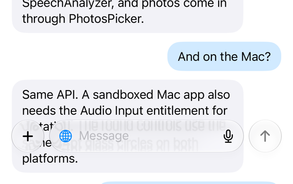
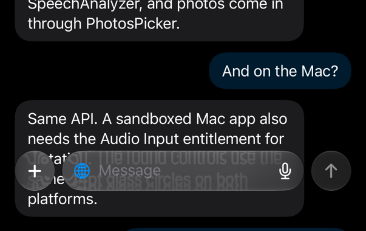
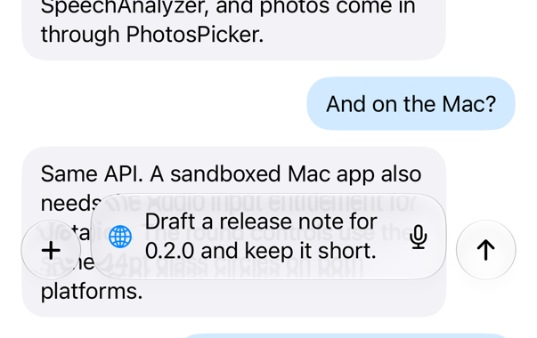
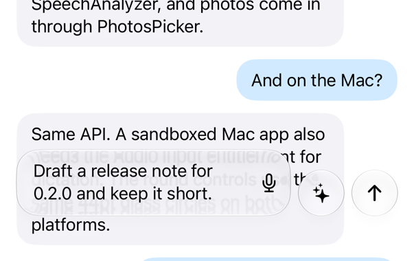
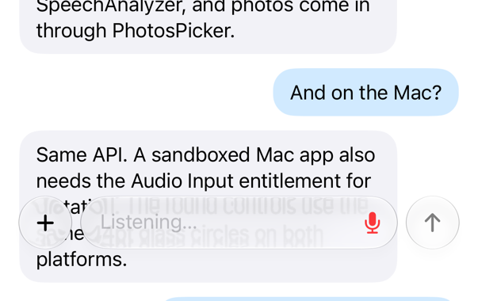
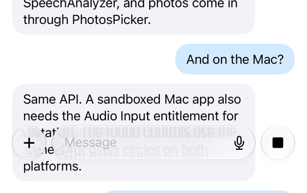

# GlassComposer

A Liquid Glass chat composer for SwiftUI: multi-line text field, on-device
dictation (`SpeechAnalyzer`), photo attachments prepared as JPEG, an optional
web-search toggle, an optional `+` menu, an optional accessory control, and a
send/stop button. Runs on iOS 26 and macOS 26 (the package floor is iOS 17 /
macOS 14 so it can sit next to older code; every type is
`@available(iOS 26, macOS 26, *)`).

<p align="center">
  
  
</p>
<p align="center">
  
  
</p>
<p align="center">
  
  
</p>

## Install

```swift
dependencies: [
    .package(url: "https://github.com/uflaks/GlassComposer", from: "0.1.0")
],
targets: [
    .target(name: "YourApp", dependencies: [
        .product(name: "GlassComposer", package: "GlassComposer")
    ])
]
```

Or in Xcode: File → Add Package Dependencies… and paste the URL.

## Host requirements

Dictation asks for the microphone and speech recognition, so the host app's
`Info.plist` needs:

- `NSMicrophoneUsageDescription`
- `NSSpeechRecognitionUsageDescription`

A sandboxed macOS app also needs the Audio Input entitlement
(`com.apple.security.device.audio-input`). Photo attachments use
`PhotosPicker`, which needs no usage description.

## Usage

```swift
import GlassComposer

struct ChatScreen: View {
    @State private var draft = ""
    @State private var attachments = ComposerAttachmentState()
    @State private var speech = SpeechInputController()
    @FocusState private var composerFocused: Bool

    var body: some View {
        ComposerView(
            text: $draft,
            selectedPhoto: $attachments.selectedPhoto,
            isFocused: $composerFocused,
            isRecording: speech.isRecording,
            onSend: { /* send draft + attachments.imageData */ },
            onToggleSpeech: {
                speech.toggleRecording(existingText: draft) { draft = $0 }
            }
        )
        .onChange(of: attachments.selectedPhoto) {
            Task { await attachments.loadSelectedPhoto() }
        }
    }
}
```

Other initializers add `onStop` (turns send into a stop button while
`isSending`), the web-search globe (`showsWebSearch` + `onToggleWebSearch`),
extra `+` menu rows (`menuExtras`, built from `ComposerPlusMenuButton`), and an
`accessory` control between the field and the send button
(`ComposerAccessoryMenu` is a round glass menu sized like the send button).
See the doc comments on `ComposerView.init` for every parameter.

## Layout

- `ComposerView` — the composer itself.
- `ComposerPlusMenuButton`, `ComposerAccessoryMenu` — menu building blocks.
- `ComposerAttachmentState`, `ComposerAttachmentSummary` — Photos picker →
  prepared JPEG.
- `VisionImagePreparer` — ImageIO downscale and encode, no UIKit.
- `SpeechInputController`, `SpeechTranscriptAssembler` — on-device dictation.

## Example and screenshots

`Example/ComposerShots` is a small iOS app that mounts the composer over a
mock chat; a `SHOT` environment variable picks the state (`empty`, `typed`,
`accessory`, `sending`, `recording`, `error`). `scripts/screenshots.sh`
builds it with xcodegen, runs each state on a simulator and writes the
cropped images under `Screenshots/`.

## Build & test

- `swift build && swift test` (macOS)
- `scripts/test-ios.sh` runs the suites on an iOS Simulator, including the
  UIKit-hosted hit-testing tests that only run there.
- `swiftlint lint`

Swift 6 language mode, swift-tools 6.0.

## License

MIT. See `LICENSE`.
